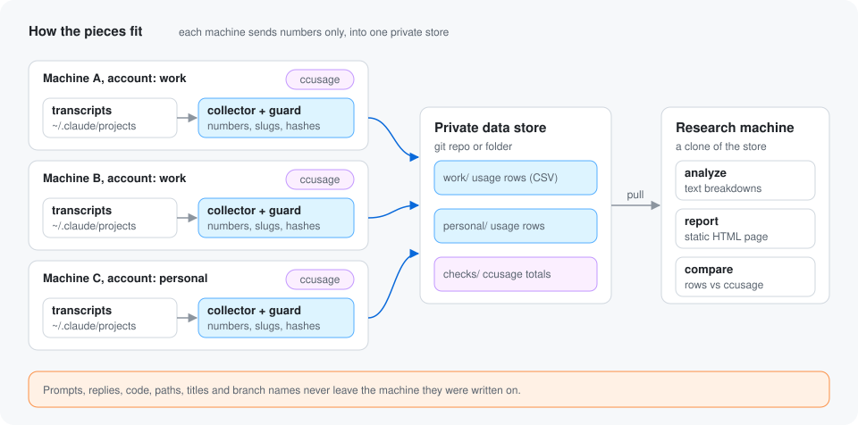

# claude-usage-collector

Turn your Claude Code transcripts into number-only usage rows and context
sizes, and combine several machines and accounts into one private store you
can study.

It costs zero tokens. It is plain Python 3.9 with no dependencies. It runs
once a day on each machine, reads only new transcript lines, and writes CSV.

Three readers fill the store:

- **Usage rows:** one row per assistant message, with its token counts,
  model, tools and agent.
- **Context sizes:** how big each context was before its first turn, and
  what it was made of (system prompt, instruction files, skill and agent
  listings, deferred tools, MCP instructions, hook output), as character
  lengths and counts. Two small files beside it record which skills were
  used and which skill and agent names were offered.
- **A weekly ccusage cross-check:** daily totals from
  [ccusage](https://github.com/ryoppippi/ccusage), stored so `compare` can
  check the rows against an independent reading.

## Privacy guarantee

**Only numbers, short labels and salted hashes ever leave the machine.**
Prompts, replies, thinking, code, tool inputs and outputs, session titles,
agent descriptions, file paths, project names and branch names stay where
they were written. So does the text of your instruction files, skills,
listings, hook output and system prompt: only its length is counted.

Four things make that hold:

- **An allowlist.** The extractor reads a fixed list of fields from each
  transcript line and ignores everything else, including fields Claude Code
  adds in future versions.
- **Salted hashes.** Project, session, agent and machine names, and by
  default every tool, skill and agent type name, become a 12 character
  HMAC-SHA256 hash. The key (the salt) is created on your machine and
  never written to the store. A local name map (`names.json`, never
  synced) lets `analyze` and `report` show the plain names on your own
  machine.
- **A fail-closed guard.** Every row of every file passes a strict check
  of every column before it is written. Each file kind has its own schema.
  One bad value anywhere means nothing is written and the run exits
  non-zero. Error messages name the file kind, row and column, never the
  value.
- **An audit before every push.** Before a git store commits, every file
  the commit could carry is read back and checked again, in full, against
  the store layout and the guard. Right before the push, every file the
  push carries is checked again as git stored it. Any stray file, wrong
  header, plain name or bad row stops the push. `claude-usage audit` runs
  the same check on every file in a store folder, including committed
  and git-ignored ones.

You can see exactly what would leave with `claude-usage collect --dry-run`.
The full details, including what the hashes do not protect, are in
[docs/privacy.md](docs/privacy.md).



## What you get

Once rows are in a store, two commands turn them into findings:

- `claude-usage analyze` prints a text report: totals, main thread versus
  subagents, usage by model and by agent type, context size bands, the
  agents and sessions with the most weighted usage, how big a context is
  before any work starts and what it is made of, the skills used most, and
  the skills and agent types that were offered but never used.
- `claude-usage report` draws the main breakdowns from `analyze` as charts
  on one static HTML page. It works offline and needs no JavaScript.

See a report built from synthetic demo data in
[docs/demo/report.html](docs/demo/report.html) (download it and open it in a
browser). Here is a preview:


## Quickstart

You need macOS or Linux, `git`, and Python 3.9 or newer. The macOS system
Python at `/usr/bin/python3` works.

```sh
git clone https://github.com/<you>/claude-usage-collector ~/claude-usage-collector
cd ~/claude-usage-collector

# 1. Write a config and a fresh salt for this machine.
#    --dest is required: the folder your usage data goes to.
./bin/claude-usage init --account work --dest ~/usage-data

# 2. Look at what would be collected. Nothing is written.
./bin/claude-usage collect --dry-run

# 3. Link claude-usage into ~/.local/bin and schedule a daily run (launchd on macOS).
./install/install.sh

# 4. Check the install.
claude-usage doctor
```

**This repo is the tool only. Your data never goes in it.** `init` fails
without `--dest`, because there is no default place for your data: you
choose it. The example above writes rows to `~/usage-data`, a plain folder.
To combine several machines, point each one at a clone of a separate
**private** git repo instead. The steps are in
[docs/multi-account.md](docs/multi-account.md).

`collect`, `sync` and `doctor` refuse a destination that sits inside this
tool's folder, or a git destination whose remote is this tool's own repo.
They cannot tell whether your data repo is private, so make it private
when you create it.

On Linux, `install.sh` links the wrapper but does not schedule anything.
Run `claude-usage run` from cron or a systemd timer.

## Commands

All commands take `--config PATH` before the command name, for example
`claude-usage --config ~/other.json collect`. Without it, the config comes
from `$CLAUDE_USAGE_CONFIG`, then `~/.config/claude-usage-collector/config.json`.

| Command | What it does |
|---|---|
| `init --account LABEL --dest PATH [--dest-type folder\|git] [--schedule HH:MM] [--force]` | Write the config and the salt. Fails without `--dest`. Refuses to replace a config without `--force`, and keeps the salt even then. |
| `collect [--dry-run]` | Read new transcript lines, guard the rows of every stream, append them to the store, save read positions. `--dry-run` prints usage row counts per day, the number of context events, skill uses and catalog names, and three sample rows, and writes nothing. |
| `sync` | For a git store: audit, commit, `pull --rebase`, push. If the audit finds a problem, nothing is committed or pushed. Does nothing for a folder store. |
| `run` | `collect`, then the weekly cross-check for each missed completed week up to 21 days back (see [docs/cross-check.md](docs/cross-check.md)), then `sync`. This is what the daily schedule calls. |
| `crosscheck [--week YYYY-Www] [--month YYYY-MM]` | Ask `ccusage` for daily totals of one ISO week (default: the last completed week, or month when `crosscheck.period` is `month`) or one month, and store them under `checks/`. |
| `compare [--store PATH] [--week YYYY-Www] [--month YYYY-MM] [--tolerance 0.02]` | Compare summed rows with the `ccusage` totals. Without `--week` or `--month` it checks every stored period. Exits non-zero if any gap is over the tolerance. |
| `analyze [--store PATH] [--since YYYY-MM-DD] [--account LABEL] [--names PATH \| --no-names]` | Print a text usage report. Shows plain names from the local name map when it exists. |
| `report [--store PATH] [--out report.html] [--since YYYY-MM-DD] [--svg PATH] [--names PATH \| --no-names]` | Write a static HTML report. `--svg` also writes the daily chart as an SVG file. Shows plain names from the local name map when it exists, so keep the output on your machine, or pass `--no-names` for one you share. |
| `audit [--store PATH]` | Check every file in the store: its path must fit the store layout, every CSV must have its schema's header and pass the guard, every check file must pass the guard, and `.gitattributes` must be what the tool writes. Exits non-zero on any problem, naming the path but never the value. Changes nothing. |
| `doctor` | Check config, salt, name hashing, store, that the store is separate from this tool's repo, git remote, schedule, `ccusage` (against the `PATH` the launchd agent runs with) and transcript retention. Changes nothing. |
| `status` | Show the last run time, rows collected and files tracked. |

`compare`, `analyze`, `report` and `audit` also work without a config, so a research
machine only needs a clone of the store:
`claude-usage report --store ~/usage-data`.

## Documentation

- [Architecture](docs/architecture.md): the modules and one daily run, step by step.
- [Privacy](docs/privacy.md): the allowlist, the guard, the threat model, and how to audit.
- [Schema](docs/schema.md): every column of every file, and the store layout.
- [Configuration](docs/configuration.md): every config key and file location.
- [Multiple machines and accounts](docs/multi-account.md): setting up a shared private store.
- [Cross-check](docs/cross-check.md): how `ccusage` is used to check the numbers.
- [Analysis](docs/analysis.md): `analyze`, `report`, starting context, weights and prices.

## Helpful questions

### Why not just use ccusage?

`ccusage` is great for "how much did I use this month on this machine". It
reads the transcripts on demand and prints totals. It does not keep a
history once Claude Code deletes old transcripts, and it does not combine
several machines or accounts. It also does not split usage by subagent,
agent type or context size, or show what your contexts are made of, which
is the point of this tool.

So this tool uses `ccusage` as an independent check instead of a
replacement. Once a week it stores the `ccusage` daily totals next to the
rows, and `compare` shows any gap. See [docs/cross-check.md](docs/cross-check.md).

### Why not OpenTelemetry?

Claude Code can export metrics and events over OpenTelemetry. That needs a
collector and a backend running somewhere, it only covers sessions from the
moment you turn it on, and you have to set it up on every machine. Some
event options can also include prompt text, so you must trust the whole
pipeline with content.

This tool works from files already on disk, needs no server, and can only
ever write the allowlisted columns. If you already run OpenTelemetry, keep
it. The two answer different questions.

### Will I lose data if I do not run it for a while?

Yes, if you wait too long. **Claude Code deletes transcripts older than
`cleanupPeriodDays`, which defaults to 30 days.** Anything deleted before a
run is gone for good.

The default is enough for the daily run and the weekly cross-check, so you
do not have to change it. Set a longer period in `~/.claude/settings.json`
if you expect to leave a machine off for weeks:

```json
{
  "cleanupPeriodDays": 365
}
```

`claude-usage doctor` warns when it is set below 22 (the weekly check can
catch up on a week that started 21 days ago), or below 62 when
`crosscheck.period` is `"month"`.

### What happens when I upgrade an existing install?

Pull the repo and keep your config and state. Old config keys keep
working, and a config without `crosscheck.period` uses the weekly check.
Every name is now hashed by default (`hash_names` defaults to `true`). An
older `"hash_agent_types": false` is ignored, and a `true` on either key
hashes. A config written by an older `init` may hold `"hash_names": false`:
that stays off, and `claude-usage doctor` warns, so set it to `true` by
hand (see
[docs/configuration.md](docs/configuration.md#which-key-decides-whether-names-are-hashed)).
Once names are hashed, rows written before the switch keep their plain
names, so per-name figures in the store split at the switch date. On the
machine that collected them, `analyze` and `report` show the plain names
from the local name map, which joins the two halves again. The map is
`names.json` beside your config, and it never leaves your machine (see
[docs/privacy.md](docs/privacy.md#the-local-name-map)). The first run after the
upgrade reads context sizes, skill uses and listed names from the start of
every transcript still on disk, and carries on with usage rows where it
left off, so no usage row is written twice. That first run is slower and
uses more memory than a daily run, and the state file grows, because it
remembers every message id it reads for 60 days to tell copied history
apart. See
[docs/architecture.md](docs/architecture.md#separate-offsets-per-stream).

### Does it cost tokens or call any API?

No. It only reads local files. The optional cross-check runs your local
`ccusage` command, which also reads local files.

### Can I run it on Windows?

Not tested. The collector is plain Python, but the installer and schedule
are for macOS, and Linux needs cron or systemd.

### What if a run fails?

It depends on where it failed.

- **Before or while writing rows** (the guard rejects a row, the store
  folder cannot be written, a git destination is not a clone yet): nothing
  is written and the read positions do not move, so the next run tries the
  same lines again. A guard failure names the transcript file the bad row
  came from.
- **In the audit before a push** (a stray file in the clone, a file
  edited by hand, a row that does not pass the guard): nothing is
  committed or pushed. The rows are in the store and the read positions
  have moved, so fix or remove the file the message names and run
  `claude-usage sync`.
- **During sync** (offline, a push is refused, a rebase conflict): the
  rows are already in the store and committed locally, and the read
  positions have moved. The next run pushes them.

Run `claude-usage doctor` and check the log at
`~/Library/Logs/claude-usage-collector.log` on macOS. An unexpected error
prints only its type; run the command again with `--debug` to see the full
traceback (it can contain local file paths, so check it before sharing).

## License

MIT. See [LICENSE](LICENSE).
