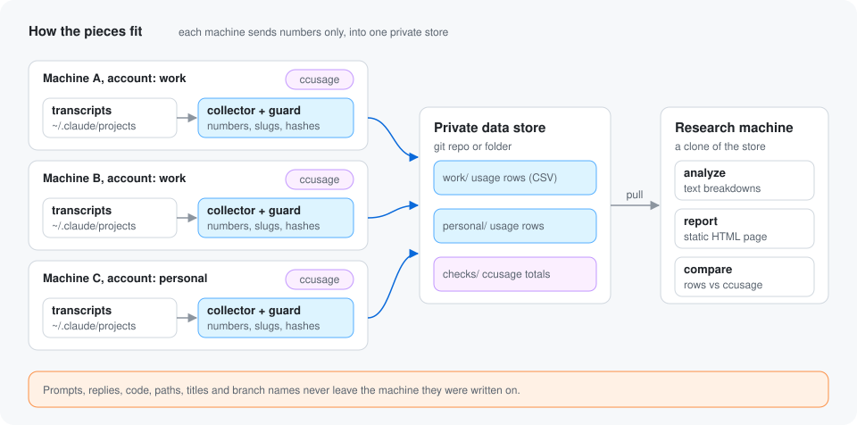
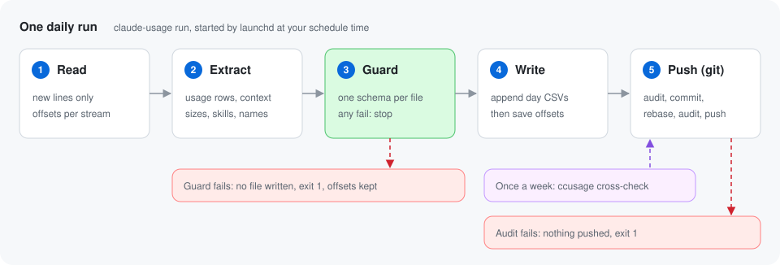

# Architecture

**Each machine runs a small collector once a day. It reads only the new
lines of each transcript, keeps an allowlist of numbers and labels, checks
every row, and appends the rows to a store.** Three readers feed the store:
usage rows (one per assistant message), context sizes (what was attached
to each context, as lengths and counts, plus skill uses and listed names),
and a weekly `ccusage` cross-check. The store is a plain folder or
a clone of a private git repo. Research happens on any machine with a copy of
the store.



The collector never sends anything over the network itself. The only thing
that leaves a machine is a `git push` of the store, and only when you choose
a git store.

## One daily run

`claude-usage run` is what the schedule calls. It does five things in order.



1. **Read.** For each transcript file it seeks to the byte offset saved by
   the last run and reads up to the last newline. A line Claude Code is
   still writing is left for next time. If a file got shorter than the saved
   offset, it is read again from the start. While a file is still active
   (changed in the last 10 minutes) and ends with an assistant message, the
   lines of that last message are left for the next run too, because more
   lines with a larger output count may still be added to it.
2. **Extract.** Each line is parsed as JSON. Malformed lines are skipped.
   Only assistant lines that carry `message.usage` become usage rows, and
   only the allowlisted fields are read from them. Names become salted
   hashes. In the same pass, the context reader measures `attachment`
   lines, and two small readers note skill uses and listed names (see
   [Context sizes](#context-sizes-skill-uses-and-listed-names) below).
3. **Guard.** Every row of every stream is checked column by column against
   that stream's schema. Any problem stops the run before anything is
   written.
4. **Write.** Rows are grouped by UTC day and appended to one CSV per day
   and stream: `YYYY-MM-DD.csv`, `.context.csv`, `.skills.csv` and
   `.catalog.csv`. All of them are staged first and moved into place
   together. Only after the write succeeds are the new offsets, seen
   message ids and marks saved.
5. **Push.** For a git store: audit, add, commit, `pull --rebase`, audit
   again, push. The first audit reads back every file the commit could
   carry, and the second reads every file the push carries as git stored
   it, so nothing reaches the remote without passing a second check (see
   [Git sync](#git-sync)).

Between write and push, `run` also stores the last completed ISO week's
`ccusage` totals if that has not been done yet, catching up on missed weeks
up to 21 days back. See [cross-check.md](cross-check.md).

`collect --dry-run` does steps 1 to 3 and prints the counts of every
stream: new usage rows per day, context events, skill uses and catalog
names. It writes nothing.

## The modules

The package is `usage_collector/`. Each module has one job.

| Module | Job |
|---|---|
| `cli.py` | The `argparse` commands and the wiring between modules. |
| `config.py` | Load and validate the JSON config, fill defaults, write it at `init`. |
| `hashing.py` | Create and load the salt. Hash a value to 12 hex characters with HMAC-SHA256. |
| `names.py` | The one name policy for agent types, skills, catalog names and tools: hash every name with `hash_names` (the default), or keep a slug and hash anything else. It remembers each hashed pair for the name map. |
| `name_map.py` | The local-only map from hashes back to plain names: merged and written beside the config by `collect`, read by `analyze` and `report` for display, refused inside the destination. |
| `models.py` | Normalise a model id, shared by rows and cross-check totals. |
| `state.py` | Local bookkeeping: byte offsets per file and per stream, seen message ids, stream marks, last run, last cross-checked week and month. |
| `extract.py` | Find transcript files, read new lines, build usage rows from allowlisted fields, and hand every line to the stream readers. |
| `records.py` | Small readers for single transcript lines, shared by every stream. |
| `context.py` | Measure one context's attachments as character lengths and counts. |
| `streams.py` | The context, skill use and catalog readers, and their dedupe. |
| `guard.py` | The fail-closed validator: one schema per stream, plus cross-check totals. |
| `audit.py` | Check every file in a store against the layout and the guard, read back from disk or, before a push, from git objects. Used by `audit` and twice in every git sync. |
| `sinks.py` | Write every stream's day files to a folder, and for a git store, sync it. |
| `doctor.py` | Read-only health checks for `claude-usage doctor`. |
| `periods.py` | ISO weeks and calendar months in UTC, and which weeks are due for a cross-check. |
| `crosscheck.py` | Run `ccusage`, keep only its totals, compare them with rows. |
| `store.py` | Read rows and check files back out of a store folder. |
| `analyze.py` | Read rows from a store and compute breakdowns. |
| `formatting.py` | Number formatting shared by the text and HTML reports. |
| `report.py` | Render those breakdowns as a static HTML page. |

`bin/claude-usage` is a small shell wrapper that runs
`python3 -m usage_collector` with the repo on `PYTHONPATH`.
`install/install.sh` links it into `~/.local/bin` and, on macOS, loads a
launchd agent built from `install/launchd.plist.template`.

## Finding transcripts

Claude Code keeps one folder per project under each source (by default
`~/.claude/projects`):

```
<source>/<project-folder>/<session-id>.jsonl
<source>/<project-folder>/<session-id>/subagents/agent-<agent-id>.jsonl
<source>/<project-folder>/<session-id>/subagents/agent-<agent-id>.meta.json
```

Subagent files are found by searching everything under `subagents/`, so
nested agents are included. From a subagent's `.meta.json` file the
collector reads only `agentType`, `spawnDepth` and `isFork`. Every other key,
including the free-text `description`, is never read into a row.

## Counting each message once

**A message is counted once even when it appears in several files or on
several lines.** Two things cause repeats:

- Claude Code can write one assistant message as several lines that share a
  `message.id`. Within one run these lines are merged: tool names are
  combined and the latest usage numbers win. The last message of an active
  file is held back until it is finished (see step 1 above), so its lines
  are not split across two runs.
- A forked session copies its parent's history, so the same `message.id`
  shows up in more than one file. The first file read keeps the row. Main
  session files are read before subagent files, so a subagent's copy of
  parent messages never replaces the parent's row. A subagent file that
  has its `meta.json` beside it is read before a copy of the same file
  without one, so the row keeps its agent type and original session.
  Between two main session files that share messages, the older file
  keeps the row, because a fork or continuation is always created after
  the session it copies. "Older" is the file's creation time where the
  platform records one (macOS does), and the path order elsewhere. When
  the first copy read had no token counts at all and a later one does,
  the later one takes the row. Ids from earlier runs are remembered in the
  state file for 60 days, then pruned.

Lines with no `message.id` and rows from the `<synthetic>` model are
skipped.

## Context sizes, skill uses and listed names

**Claude Code writes `attachment` lines into a transcript for everything it
loads into a context: instruction files, the skill listing, agent and
deferred tool listings, MCP instructions, hook output and a snapshot of the
system prompt.** The context reader adds up their character lengths and
counts, and never keeps the text. [schema.md](schema.md#context-size-columns)
lists the columns and [privacy.md](privacy.md#context-sizes-measured-never-copied)
lists which field becomes which number.

- **Events.** Each transcript file, main session or subagent, gets a
  `start` event for what was attached before its first assistant turn, and
  a `compact` event for what was attached after each `compact_boundary`
  line. An event becomes a row when its first assistant turn arrives, and
  that turn's context size goes in `first_turn_context`. A turn with no
  input or cache tokens at all does not count as that turn: the event
  waits for the next one. A `compact_boundary` before the file's first
  turn is part of the `start` event, so it is not a `compact` event here,
  while the usage rows mark the first row after it as `compacted`.
- **Waiting for the turn.** An event that has opened but has no turn yet
  stays open. Its stream offset stays where the event opened, so the next
  run measures it again in full. The other streams are not read twice.
- **Skill uses.** An `invoked_skills` attachment adds one row per skill the
  first time that session and agent uses it.
- **Listed names.** Skill listings and agent listings add one catalog row
  per UTC day, kind and name, so `analyze` can show names that were offered
  but never used.

### Separate offsets per stream

**Each transcript file has one read offset per stream in the state file.**
The usage offset is the one older versions saved. A file entry written by
an older version has no context, skills or catalog offset, so those
streams start at 0 and read the whole file, while usage rows carry on from
the old offset. That way an existing install backfills context sizes, skill
uses and listed names from every transcript still on disk on its first run
after an upgrade, and repeats no usage row.

Each run reads a file from the lowest offset of its streams, and a line is
passed only to the streams that have not read it yet.

### Forks and copied history

**A forked session copies its parent's history, attachments included, so
the stream readers remember what they have passed.** Every assistant
message id they pass, and the line `uuid` of every `invoked_skills`
attachment, is kept as a stream mark. When a reader meets a turn it has
already passed, the history is a copy: whatever it had measured so far is
dropped. A file that opens with copied history gets a `fork` event instead
of a `start`, built only from what was attached after the last copied
turn, and it closes on the fork's first new turn. Its first turn holds the
whole copied conversation, so `analyze` counts fork events apart from
starts. A compaction inside the copied history is never a `compact` event:
when the turn after a boundary is a copy, the pending event is dropped, as
the usage rows do with their `compacted` flag. The context offset moves
past every copied turn, so copied history is not read again once its marks
are pruned, and a fork still waiting for its first turn is noted in the
state file so it stays a fork on the next run. Skill uses and catalog names have their own marks (by
session, agent and skill, and by day, kind and name), so repeats are
skipped across runs too. All marks are pruned after 60 days, like the seen
message ids.

## Compaction

When Claude Code compacts a conversation it writes a `compact_boundary`
line. The next usage row in that file gets `compacted=1`. If the boundary is
the last thing in a file, that flag waits in the state file for the next
run. If a message that was already counted follows the boundary, the
boundary is part of history copied from a parent session, so the flag is
dropped: the compaction was already counted in the parent.

## Git sync

**The git store syncs in the order audit, add, commit, `pull --rebase`,
audit again, push.**
Pulling first would fail, because `collect` has already written files into
the working tree by then.

- The audit runs first. It lists every staged, changed or untracked file
  in the clone with `git status`, and checks each one in full against the
  store layout and the guard (see
  [privacy.md](privacy.md#4-the-audit-checks-every-file-again-before-a-push)).
  Any problem stops the sync before the commit, so nothing is committed or
  pushed, the state file is untouched, and the run exits non-zero.
- The second audit runs right before the push. It lists every file that
  changed between the remote branch and `HEAD` (or every tracked file when
  the remote branch does not exist yet) with `git ls-tree` and `git diff`,
  and checks each one as git stored it, read with `git cat-file`. A local
  commit made by hand, or a git filter that changed a file while it was
  committed, is caught here. A tracked link or embedded repository fails
  too. Any problem stops the push.
- The sink writes a `.gitattributes` file with `*.csv merge=union`. Two
  machines on the same account that append to the same day file then merge
  cleanly, with no repeated header.
- Commits use a neutral identity (`claude-usage-collector`), so no personal
  email lands in the data repo. The message is `usage: <account> <date>`.
- If the rebase fails, it is aborted and the run exits non-zero. The local
  commit stays, so the next run tries again.

## State and local files

These files live next to the config, by default in
`~/.config/claude-usage-collector/`. None of them is ever written to the
store.

| File | Holds |
|---|---|
| `config.json` | Your settings. Mode 600. |
| `salt` | 32 random bytes, hex encoded. Mode 600. |
| `state.json` | Offsets per transcript file and stream, seen message ids, stream marks, last run, last cross-checked week (`crosscheck_week`) and month. Mode 600. |

Deleting `state.json` makes the next run read every transcript from the
start. Rows of every stream already in the store would then be written
again, so only do that with an empty store.

## Known limits

- **A new model name that is not a simple slug blocks collection.** The
  guard rejects it on purpose (fail closed). Collection stays blocked until
  the extractor learns the name.
- **A forked main session is recognised only after its parent.** Main
  session files are read by path, so a forked main session is seen as a
  copy only when its parent's file is read first in the same run, or was
  read in an earlier run. This is the same order the usage dedupe uses.
  Subagent forks are always read after main files.
- **A message split across two runs loses its tail.** If Claude Code writes
  the later lines of a message after a run has already read the first one,
  those later tool names and the final output count are not added.
