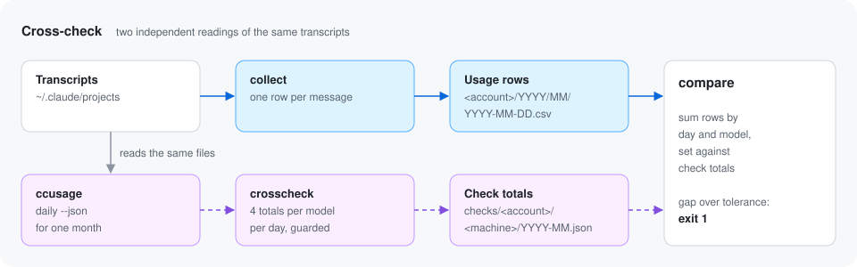

# Cross-check with ccusage

**`ccusage` reads the same transcripts in its own way, so its daily totals
are an independent check on the collector.** It is pointed at the folders
in your config's `sources`, so it sees the same files the collector reads. Once a week the collector
stores those totals next to the rows. `compare` then sums the rows the same
way and shows any gap.



[ccusage](https://github.com/ryoppippi/ccusage) is a separate open source
tool. Install it yourself if you want the cross-check. Everything else works
without it.

## Why a cross-check helps

A collector that silently drops or doubles rows would give wrong research
results that look fine. Two things make that a real risk:

- Claude Code's transcript format is not a documented API and can change.
- Forked sessions copy their parent's messages, so naive counting double
  counts.

If both tools agree day by day and model by model, both are probably
reading the files right. If they disagree, `compare` tells you where to
look.

## What is stored

`claude-usage crosscheck` runs:

```sh
CLAUDE_CONFIG_DIR=<folder holding each projects source> \
  ccusage daily --json --since YYYYMMDD --until YYYYMMDD --timezone UTC
```

for one ISO week (Monday to Sunday, in UTC), or for one calendar month
when you ask for a month. It never runs the `ccusage session` report, which
includes project paths.

- `CLAUDE_CONFIG_DIR` is the parent of each folder in `sources`, joined
  with commas. With the default source `~/.claude/projects` that is
  `~/.claude`. Every source must end in `projects`, or the cross-check
  stops with an error.
- `--timezone UTC` makes `ccusage` group days in UTC, the same way rows are
  grouped. Without it, `ccusage` uses your system time zone and every day
  would be shifted against the rows. It needs a `ccusage` version that has
  the `--timezone` option.

From the JSON it keeps, per day and per model, only four integers: input,
output, cache read and cache write tokens. Costs, project names and any
other field are dropped. The result goes through the same fail-closed guard
as rows, then into `checks/<account>/<machine>/YYYY-Www.json` in the store
(for example `2026-W09.json`). A month check goes into `YYYY-MM.json`
beside it, and month files written by older versions keep being read.
Each machine has its own file, so two machines sharing one account label
never edit the same file, and `compare` adds their totals up. The format
is in [schema.md](schema.md#cross-check-totals).

## When it runs

- **Automatically,** as part of `claude-usage run`, for the most recent
  completed ISO week, until that week has been stored once. Because both
  the rows and `ccusage` use UTC days, the week is complete as soon as
  Sunday is over in UTC, even if it is still Sunday evening on your clock.
  It runs between collect and sync, so the totals are pushed in the same
  run.
- **Catching up:** a machine that was off for a while checks every week it
  missed on its next run, oldest first. A week that started more than 21
  days ago is skipped instead, and the run log says so, because its
  transcripts may already be deleted and the totals would be low.
- **By hand,** for any week or month:

```sh
claude-usage crosscheck                    # the last completed week
claude-usage crosscheck --week 2026-W09
claude-usage crosscheck --month 2025-12
```

The automatic run is skipped quietly when `crosscheck.enabled` is `false`.
When the command cannot be found it is skipped too, and the run log gets
one line: `skipped cross-check: ccusage command not found`. To go back to the older monthly schedule,
set `crosscheck.period` to `"month"`. The run then checks the previous UTC
month once, and `crosscheck` without a flag does the same.

### When ccusage comes from nvm or another version manager

**The launchd agent runs with the `PATH` of the shell that ran
`install/install.sh`, saved into the agent when it was installed.** A bare
`ccusage` works as long as it was on that `PATH`. A version manager such
as nvm puts the Node version into the folder name, so after a Node upgrade
the saved `PATH` points at a folder that is gone. The cross-check is then
skipped with one line in the run log, and no week is stored. Run the
installer again, or put the absolute path in `crosscheck.command`:

```json
"crosscheck": {"command": "~/.nvm/versions/node/<version>/bin/ccusage", "enabled": true, "period": "week"}
```

`crosscheck.command` can be a bare name, found through `PATH`, or a path.
A path may start with `~/`, which means your home folder. Run
`command -v ccusage` in a terminal to see the path to use.

A full path alone is not always enough. A ccusage installed with npm starts
with `#!/usr/bin/env node`, so it still needs `node` on `PATH`. To make that
work, the collector adds two folders to the front of `PATH` for the
ccusage process only: the folder of the path you gave, and the folder of
the file it finally points to after following symlinks. A version manager
keeps `node` in one of those, so it is found. Nothing else the collector
runs sees the changed `PATH`.

The path names a Node version, so **upgrading Node through the version
manager changes it**. Update `crosscheck.command` after an upgrade, or the
cross-check stops running. `claude-usage doctor` checks the command
against the `PATH` the installed launchd agent runs with, and warns when
launchd cannot find it. Without an installed agent it checks your own
`PATH`.

### Why weekly: transcript retention

`ccusage` only sees transcripts that still exist, and Claude Code deletes
them after `cleanupPeriodDays` (30 days by default). A monthly check run on
the first of the month needs the files from up to 31 days back, so with the
default setting the first days of the month were already gone and the
totals came out low. A weekly check needs files from at most about 13 days
back, plus up to 21 days when it catches up after a break: the oldest week
it still checks starts 21 days ago. The default 30 days covers that, so you
no longer need to raise `cleanupPeriodDays` for the cross-check.
`claude-usage doctor` warns when it is set below 22, the shortest period
that still keeps the oldest day a catch-up reads. If you set
`crosscheck.period` to `"month"`, keep it at 62 days or more. Doctor then
warns below 62, and also when the setting is unset.

## Comparing

```sh
claude-usage compare --store ~/usage-data --week 2026-W09
claude-usage compare --store ~/usage-data --month 2025-12 --tolerance 0.05
```

For each account, day and model, `compare` sums the rows and sets them
against the stored totals, one token kind at a time. Each check file is
compared on its own, against the rows of its own week or month. `--week`
and `--month` pick one file by its name, so `--month` finds month files
only. Without either it checks every week and month that has a check
file. `--store` defaults to the destination in your config. It prints a
table of the gaps and exits non-zero if any gap is larger than the
tolerance. The default tolerance is `0.02`,
which means 2 percent.

## Reading a gap

Small gaps are normal. Larger ones usually have a plain cause:

- **Rows below the totals for the last days of a week or month:** it was
  checked before the collector caught up. Run `collect`, then compare again.
- **Rows below the totals across a whole day:** a run was blocked by the
  guard, or transcripts were deleted before collection. Run
  `claude-usage doctor`.
- **Rows above the totals:** messages counted twice. Check whether
  `state.json` was deleted while the store already had rows.
- **A model missing on one side:** the two tools may name or group models
  differently. Look at the model names in the check file and in the rows
  for that day.

The two tools are independent, so neither is the truth by definition. A
gap means "look here", not "the collector is wrong".
