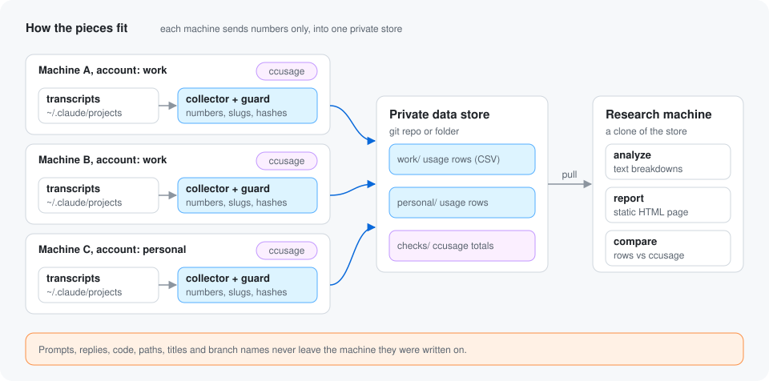

# Multiple machines and accounts

**Give every machine a clone of one private git repo as its store. Each
machine appends its own rows and pushes once a day. Any clone of that repo
then holds every machine's data.** The rows contain no content, but they
still describe your working life, so the data repo must be private.



## Never use the tool repo as the store

**Create a separate, private repository for the data.** Do not push rows to
your fork or clone of `claude-usage-collector`, which is public. The tool's
`.gitignore` ignores `*.csv` to help prevent that mistake, but a separate
repo is the real protection.

## 1. Create the private data repo

On your git host, create an empty **private** repository, for example
`usage-data`. Add a first commit so the `main` branch exists (a README is
enough).

## 2. Set up the first machine

```sh
git clone git@example.com:<you>/usage-data.git ~/usage-data

git clone https://github.com/<you>/claude-usage-collector ~/claude-usage-collector
cd ~/claude-usage-collector
./bin/claude-usage init --account work --dest-type git --dest ~/usage-data
./install/install.sh
claude-usage doctor
```

`doctor` checks that `~/usage-data` is a git clone and that the remote can be
reached. Run `claude-usage run` once by hand to see the first push.

The machine must be able to push without a prompt, because the daily run is
not interactive. Use an SSH key or a credential helper.

## 3. Add a second machine on the same account

Repeat step 2 on the new machine with the **same** account label:

```sh
./bin/claude-usage init --account work --dest-type git --dest ~/usage-data
```

**This is safe.** Rows from both machines land in the same day files, and
the `machine` column tells them apart. The git sink sets `*.csv merge=union`
in `.gitattributes`, so two machines appending to the same file merge
without a conflict.

## 4. Add a machine for another account

Use a different label, such as `personal`:

```sh
./bin/claude-usage init --account personal --dest-type git --dest ~/usage-data
```

That machine writes only under `personal/` and `checks/personal/<machine>/`, so its
pushes never touch the `work` files.

## 5. Read everything from a research machine

Any clone of the data repo works, next to a clone of the tool. No config,
salt or schedule is needed:

```sh
git clone git@example.com:<you>/usage-data.git ~/usage-data
git clone https://github.com/<you>/claude-usage-collector ~/claude-usage-collector
cd ~/claude-usage-collector
./bin/claude-usage analyze --store ~/usage-data
./bin/claude-usage report --store ~/usage-data --out ~/usage-report.html
```

Run `git pull` in `~/usage-data` before each look to get the latest rows.

## Matching hashes across machines

**By default each machine has its own salt, so the same project, skill or
agent type gets a different hash on each one.** That is the most private
choice. It also means analysis cannot tell that a project on two machines
is the same project, and a machine's name map turns only its own hashes
back into names.

Sharing one salt between your own machines is an option. It makes every
hash match, so one name map shows plain names for every machine's rows,
and per-name figures line up. The cost is that one leaked salt exposes
every machine's rows to guessing, not just one. Share it only between
machines you own and trust equally.

If you want hashes to match, share one salt before running `init` on the
next machine. `init` keeps a salt file it finds in the config folder:

```sh
mkdir -p ~/.config/claude-usage-collector
chmod 700 ~/.config/claude-usage-collector
# copy the salt file from the first machine over a secure channel, then:
chmod 600 ~/.config/claude-usage-collector/salt
./bin/claude-usage init --account work --dest-type git --dest ~/usage-data
```

Machine hashes still differ, because they come from each hostname.
Each machine still keeps its own `names.json`. To read names from all of
them in one place, merge their maps by hand on the research machine and
pass it with `--names` to `analyze` or `report`. Copy maps only over a secure channel, and
never into the store.
Anyone with the shared salt can test guesses against every machine's hashes,
so treat it like a private key.

## Two accounts on one machine

If you use two Claude Code accounts on one machine, each with its own
Claude Code config folder, give each one its own collector config:

```sh
claude-usage --config ~/.config/claude-usage-collector/config.json \
  init --account work --dest-type git --dest ~/usage-data
claude-usage --config ~/.config/claude-usage-collector-personal/config.json \
  init --account personal --dest-type git --dest ~/usage-data
```

Then edit `sources` in each config to point at the right `projects` folder.
Each config folder has its own salt and its own read positions.

The cross-check follows `sources` too. It runs `ccusage` with
`CLAUDE_CONFIG_DIR` set to the folder that holds each `projects` source, so
each config's check totals cover only that account's transcripts. Keep each
source path ending in `projects` (for example
`~/.claude-personal/projects`), or the cross-check stops with an error.

`install/install.sh` installs one launchd agent, for one config. Schedule the
second config yourself, for example with cron:

```cron
30 18 * * * $HOME/.local/bin/claude-usage --config $HOME/.config/claude-usage-collector-personal/config.json run
```

## When a sync fails

**A failed sync loses nothing.** If `pull --rebase` hits a conflict, the
rebase is aborted, the run exits non-zero, and the local commit stays.

- **Offline or a refused push:** the next run pulls and pushes again.
- **A real conflict:** this repeats on every run until you fix it, and no
  later rows are pushed meanwhile. Day files merge by appending and each
  machine writes its own check files, so a conflict means two machines
  write the same file: usually two machines with the same `machine_label`.
  Give each machine its own label (or leave it `null`), then open
  `~/usage-data`, resolve it with normal git commands, and run
  `claude-usage sync`.

Only the collector's own paths (`.gitattributes`, your account folder and
`checks/<account>/`) are ever committed. Before that, every file that git
sees as new or changed anywhere in the clone is audited, and before the
push every file the push carries is audited again, as git stored it. A
file that does not fit the store layout (a note, a script, a stray
`.DS_Store` unless your gitignore already skips it) stops the sync, even
if it would not be committed, so keep the clone for data only. A commit
you made by hand in the clone stops it too.

`claude-usage audit` shows what is wrong without changing anything. It
checks every file in the store folder, including committed and
git-ignored ones. The check before a push covers only files git sees as
new or changed, and the files the push carries.
