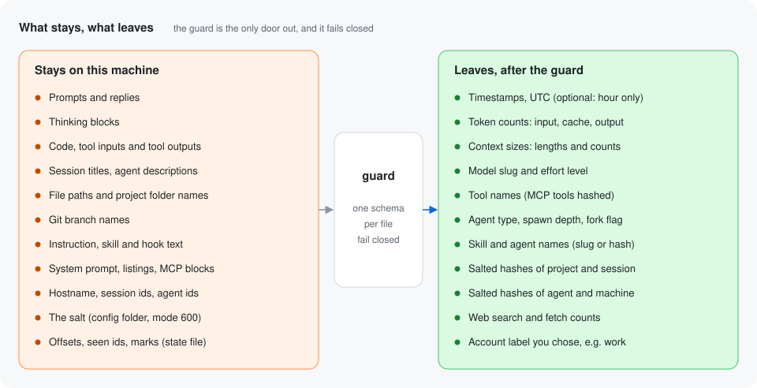

# Privacy

**Session content never leaves the machine. Only timestamps, token counts,
character lengths, short labels and salted hashes do, and only after a
strict check of every value.** This page explains how that is enforced, what the hashes do and do
not hide, and how to check it yourself.



## What leaves, and what never does

These are the only values written to the store. The full column list is in
[schema.md](schema.md).

| Leaves the machine | Form |
|---|---|
| When a message happened | UTC timestamp, optionally rounded to the hour |
| Token counts | input, cache read, cache write, output, and their sum |
| Web search and fetch counts | integers |
| Model and effort | a slug such as `claude-opus-5-5`, and `low` to `max` |
| Tool names | salted hashes by default; MCP tools always `mcp:<hash>`; slugs such as `Read` only with `hash_names` off |
| Agent type, spawn depth, fork flag | a salted hash by default (a slug such as `Explore` only with `hash_names` off), an integer, 0 or 1 |
| Project, session, agent, machine | 12 character salted hashes |
| Account | the label you chose, such as `work` |
| Sizes of what was attached to a context | character lengths and counts, never the text (see below) |
| Skill names that were used | a salted hash by default (a slug such as `code-review` only with `hash_names` off) |
| Skill and agent names that were listed | salted hashes by default (slugs only with `hash_names` off), one per day |

These never leave, because the extractor never reads them into a row:

- prompts, replies and thinking
- code, tool inputs and tool outputs
- session titles and subagent descriptions
- file paths, project folder names and git branch names
- hostnames, raw session ids and raw agent ids
- the salt, the config, the state file and the local name map
  (`names.json`)
- the text of instruction files, skill listings and skill files, agent
  listings, deferred tool lines and descriptions, MCP instructions, hook
  output and the system prompt, and every path in them

### Context sizes: measured, never copied

**For what Claude Code attaches to a context, only the length of each text
leaves, never the text.** These attachment fields hold free text. The
collector passes each one to a length count and keeps only the number.

| Attachment | Field | What leaves |
|---|---|---|
| `prompt_snapshot` | `systemPrompt` | `system_prompt_chars` |
| `instructions` | each file's `content` | its length, added to `instr_user_chars`, `instr_project_chars`, `instr_local_chars`, `instr_memory_chars` or `instr_other_chars` by the file's `type` |
| `instructions` | each file's `path` | nothing; files are only counted in `instr_files` |
| `skill_listing` | `content` | `skill_listing_chars` |
| `skill_listing` | `skillCount` | `skill_count` |
| `skill_listing` | `names` | catalog rows under the name rule, and `skill_count` when `skillCount` is missing |
| `agent_listing_delta` | `addedLines` | `agent_listing_chars` |
| `agent_listing_delta` | `addedTypes` | `agent_count`, and catalog rows under the name rule |
| `agent_listing_delta` | `builtInTypes` | catalog rows under the name rule |
| `deferred_tools_delta` | `addedLines` | `deferred_tools_chars` |
| `deferred_tools_delta` | `addedNames` | `deferred_tool_count` only |
| `deferred_tools_record` | each entry's `name`, `description`, `input_schema` | their lengths, added to `deferred_tools_chars`, and `deferred_tool_count` |
| `mcp_instructions_delta` | `addedBlocks` | `mcp_chars` |
| `mcp_instructions_delta` | `addedNames` | `mcp_server_count` only |
| `hook_additional_context` | `content` | `hook_context_chars` |
| `invoked_skills` | each skill's `name` | a skill use row, under the name rule |
| `invoked_skills` | each skill's `path` and `content` | nothing |

Deferred tool names and MCP server names are counted, never written, not
even as hashes. Every other field of an attachment, such as `hookName` or
`digests`, is never read.

"The name rule" means every name becomes a salted hash, because
`hash_names` is on by default. With `hash_names` off, a name that is a
simple slug is written as is, and anything else still becomes a hash.

## The local name map

**When a name is hashed, `collect` writes the hash and its plain name to
`names.json` beside your config, and nowhere else.** That lets `analyze`
and `report` show names you recognise while the store holds only hashes.

- It lives in the config folder (for example
  `~/.config/claude-usage-collector/names.json`), with mode 600, next to
  the salt.
- It is written atomically and merged across runs, so names from earlier
  runs are kept.
- It is never written to the destination and never synced or pushed.
  If the config folder sits inside the destination folder, `collect`
  refuses to run, because the map would land in the store.
- `collect --dry-run` does not write it.
- `analyze` and `report` only read it, to show plain names in their
  output. A report built with the map shows plain names, so treat
  `report.html` and any `--svg` file like the map: keep them on your
  machine. Use `--no-names` for a report you want to share. `report`
  refuses to write a report with plain names inside the store.
- Delete it at any time. The next `collect` starts a new map, but it only
  learns names from new transcript lines, so rows already in the store
  keep showing as hashes.
- If it cannot be read (a hand edit or a crash while it was written),
  `collect` keeps the old file as `names.json.bad`, starts a new map and
  carries on. `analyze` and `report` show hashes instead.

Treat it like the salt: it holds the plain names the store hides.

## How it is enforced

**Four layers each block content on their own.** The last two are
separate checks of the same files at two different moments: the guard
checks rows before they are written, and the audit checks the written
files again before a git store pushes them. The guard and the audit share
the same column schemas, so they catch different mistakes (a bad row at
write time, a bad or stray file at push time), not a mistake in a schema
itself.

### 1. The extractor reads an allowlist

`extract.py` reads named fields from each transcript line: `type`,
`subtype`, `timestamp`, `effort`, and inside `message`: `id`, `model`,
`usage` and the `name` of each `tool_use` item. From `attachment` lines,
`context.py` and `streams.py` read only the fields in the table above, plus
the line's `uuid`. The `uuid` is used only to notice history copied into a
forked session, and is never written. Nothing else is touched. New fields that Claude Code adds later are ignored without any code
change. From a subagent's `.meta.json` it reads only `agentType`,
`spawnDepth` and `isFork`.

Values that might be free text are reduced before they reach a row:

- A tool name that is not a simple slug becomes a hash. Every MCP tool name
  (`mcp__<server>__<tool>`) becomes `mcp:<hash>`, because server names can
  be private.
- Every agent type, skill name, listed name and tool name becomes a hash
  while `hash_names` is on, which is the default. With it off, only names
  that are not simple slugs do. One shared name policy (`names.py`) does
  this for all of them, so `hash_names` covers them all at once. The
  guard and the audit check the result: while `hash_names` is on they
  refuse any of these names that is not a hash (see below).
- Attached text becomes its length, as described above.
- An `effort` value outside `low`, `medium`, `high`, `xhigh`, `max` becomes
  empty.

### 2. Names become salted hashes

Project folder, session id, agent id and hostname are hashed with
HMAC-SHA256, keyed with a 32 byte random salt, and cut to 12 hex
characters. The salt is created by `init` in your config folder with mode
600. It is never written to the store.

### 3. The guard fails closed

`guard.py` checks every row of every file before anything is written.
Usage rows, context sizes, skill uses and catalog rows each have their own
schema:

- Each column has a strict rule: a timestamp or date pattern, a slug
  pattern of at most 64 characters with no spaces, a 12 hex hash pattern,
  a fixed list of values, or a non-negative integer up to 10^9.
- An unknown column or a missing column is a problem.
- While `hash_names` is on, the agent type, skill and listed name columns
  must hold a hash, and every tool must be a hash or `mcp:` plus a hash.
  A plain name is a problem even when it is a valid slug.
- `context` must equal input plus cache read plus cache write, and a main
  thread row must have an empty agent.

**If any row of any file has any problem, nothing is written, the command
exits 1, and the read offsets do not move.** The error names the file kind,
row number and column (for example `context row 0: column event is
invalid`), never the value, so a rejected value cannot leak through the log
either.

The same guard checks `ccusage` totals before they are stored.

### 4. The audit checks every file again before a push

**A git store is audited twice: before it commits, and again right before
it pushes.** Each time `audit.py` checks the whole of each file, not only
the rows added by this run. It does not trust the writer or anything
already on disk: it re-runs the guard's schemas on what was actually
written. A file edited by hand, a stray note dropped into the clone, or a
row written by a buggy older version is caught here even though the
guard never saw it.

- **Before the commit** it reads from disk every file that is staged,
  changed or untracked anywhere in the clone. Files git ignores are not
  part of a commit, so they are not checked here.
- **Before the push** it reads every file the push carries, as git stored
  it, not as it sits on disk: every file changed between the remote
  branch and the local branch, or every tracked file when the remote
  branch does not exist yet. That covers a commit made by hand in the
  clone, a commit left over from a push that failed, and content that a
  git filter changed while committing. A tracked link or an embedded
  repository fails here too.

- **The path must fit the store layout exactly:** `.gitattributes`,
  `<account>/YYYY/MM/YYYY-MM-DD.csv` (and `.context.csv`, `.skills.csv`,
  `.catalog.csv`), or `checks/<account>/<machine>/YYYY-MM.json` or
  `YYYY-Www.json`. The month file an older version wrote straight into
  `checks/<account>/` is also accepted. Any other path fails, and so does
  a symbolic link.
- **Every CSV must have exactly its schema's header,** and every row must
  pass the guard's schema for that kind of file, including the hashed
  name rule while `hash_names` is on.
- **Every check file must pass the guard** for `ccusage` totals, and may
  not repeat a key (a repeated key could hide a value the JSON reader
  drops).
- **`.gitattributes` must hold exactly what the tool writes.**

**If anything fails, nothing is committed or pushed and the command exits
1.** The state file is not touched, and the files stay where they are so
you can fix them. Each problem names the file's path inside the store and
what is wrong (for example `work/2026/03/2026-03-01.csv: row 0: column
model is invalid`), never the value.

The same check runs on its own with `claude-usage audit`, which works on a
folder store too and changes nothing. It checks every file in the store
folder, including committed and git-ignored ones, so it can report files
the push would never carry. With a folder store nothing is ever pushed,
so run it yourself before you copy the folder anywhere. It applies the
hashed name rule when your config has `hash_names` on, and not when it
runs without a config.

Files written before `hash_names` was on hold plain names, so a full
`claude-usage audit` reports them once hashing is on. A git store only
checks what it is about to commit or push, so older files only matter if
they change again.

## Threat model

**The design assumes someone you do not fully trust might read the store.**
It is built so that reading the store tells them how much you used Claude
Code, and when, but not what you worked on.

What a reader of the store can learn:

- **Your usage pattern.** Timestamps show when you work. Set
  `round_ts_to_hour` to blur this to the hour.
- **How many tools, agent types and skills you use, and how often, but
  not their names.** With `hash_names` on (the default), every agent
  type, skill name, catalog name and tool name in the store is a hash.
  A reader sees that one hash is used more than another, and how many
  different names were listed on a day, but not what they are called.
  If you set `hash_names` to `false`, `doctor` warns, and names that are
  simple slugs are written as is: the built-in ones (`Explore`, `general-purpose`, `Read`,
  `Bash`), but also agents and skills you define yourself and plugin
  agents such as `plugin:agent`. Do that only if none of your names
  mention projects, clients or teams. MCP tool names are always hashed.
- **How large your setup is.** Context sizes show how long your
  instruction files, listings and system prompt are, and how many skills,
  agents, deferred tools and MCP servers were offered. They do not show
  what any of them say.
- **Model ids.** A model id containing `claude-` is kept from that point
  on (a provider prefix or an `@version` suffix is dropped). Any other
  model id, such as a custom gateway name, is hashed, and a missing one
  becomes `unknown`.
- **How many projects and sessions you have,** and which rows belong
  together, through the hashes.
- **Your labels.** The account label, and `machine_label` if you set one,
  are written as is. Pick neutral labels.

What a reader cannot learn without the salt:

- **The names behind the hashes.** Without the salt, a hash cannot be
  checked against a guessed project or skill name. The local name map
  that turns hashes back into names never reaches the store.

What the hashes do not protect against:

- **Someone with your salt.** They can hash guessed names and compare. Keep
  the salt as private as your SSH keys. Never commit it.
- **Someone with access to your machine.** They can read the transcripts,
  the salt and the name map directly. This tool does not change that.

Keep the store in a **private** repository. Never push it to the public tool
repo. The tool helps here: `init` has no default store, so you must choose
one, and `collect`, `sync` and `doctor` refuse a store inside the tool's
folder or a git remote that is the tool's own repo. It cannot check that
your data repo is private, so that part is up to you. See
[multi-account.md](multi-account.md).

## How to audit it yourself

**Run a dry run and read what would be written.**

```sh
claude-usage collect --dry-run
```

It prints the number of new usage rows per day, the number of new context
events, skill uses and catalog names, and the first three usage rows as
CSV. It writes nothing and does not move the offsets.

Then search the real store for words that must never appear. Pick words
from your own work: a project name, a branch name, a phrase from a prompt.

```sh
grep -rIl -e 'my-secret-project' -e 'feature/some-branch' ~/usage-data
```

No output means no match. The search covers the context, skills and
catalog files too. A good extra test is a phrase from one of your own
`CLAUDE.md` files or skills. You can also open any CSV in a spreadsheet:
every cell is a number, a hash, a timestamp or a short label.

Finally, run the audit. It checks every file in the store against the
layout and the guard, prints only paths and problems, and changes nothing:

```sh
claude-usage audit --store ~/usage-data
```

The test suite checks the same thing on synthetic transcripts that contain
marker strings in titles, paths, branches, prompts, tool inputs, replies and
agent descriptions, and in every free-text attachment field: instruction
content and paths, skill listings, skill content and paths, agent listing
lines, deferred tool lines and descriptions, MCP blocks, hook output and
the system prompt. Non-slug skill, agent, MCP and deferred tool names carry
markers too. It asserts that none of them appears anywhere in the written
store, in any file.
