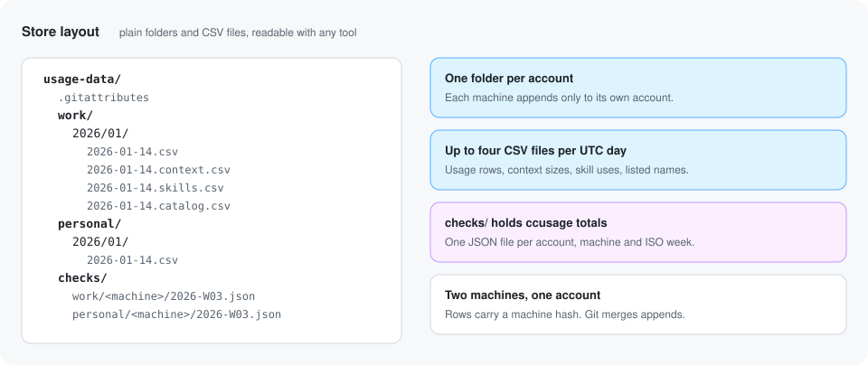

# Schema

**Each usage row is one assistant message: when it happened, who made it
(as hashes), which model, and how many tokens it used.** Usage rows are CSV
with a header, 21 columns, in the order below. Three smaller CSV files sit
beside them: context sizes (one row per starting or compacted context),
skill uses, and the names offered in skill and agent listings. Cross-check
totals are JSON.

## Usage row columns

File: `<account>/YYYY/MM/YYYY-MM-DD.csv`.

| Column | Type | Meaning |
|---|---|---|
| `ts` | `YYYY-MM-DDTHH:MM:SSZ` | When the message was written, in UTC. With `round_ts_to_hour` the minutes and seconds are `00`. |
| `account` | slug | The account label from your config, such as `work`. |
| `machine` | hash or slug | Salted hash of the hostname, or `machine_label` if you set one. |
| `project` | hash | Salted hash of the project folder name. |
| `session` | hash | Salted hash of the session id. |
| `agent` | hash or empty | Salted hash of the subagent id. Empty on the main thread. |
| `is_subagent` | 0 or 1 | 1 when the row came from a file under `subagents/`. |
| `agent_type` | slug, hash or empty | `agentType` from the subagent's meta file, such as `Explore`. Hashed when `hash_names` is on (the default), or when it is not a simple slug. Empty on the main thread. |
| `spawn_depth` | integer or empty | `spawnDepth` from the meta file: how deep in a chain of agents this one was started. Empty on the main thread. |
| `is_fork` | 0 or 1 | 1 when the meta file says `isFork: true`. |
| `model` | slug or hash | The model name, such as `claude-opus-5-5`. Ids from other providers are cut to the part from `claude-` on, so `us.anthropic.claude-opus-4-1-v1:0` becomes `claude-opus-4-1-v1:0` and `claude-opus-4-1@20250805` becomes `claude-opus-4-1`. Any other id is hashed. A missing id is `unknown`. |
| `effort` | `low`, `medium`, `high`, `xhigh`, `max` or empty | The reasoning effort, when Claude Code recorded one. |
| `input` | integer | Input tokens not served from cache. |
| `cache_read` | integer | Input tokens read from the prompt cache. |
| `cache_write` | integer | Input tokens written to the prompt cache. |
| `output` | integer | Output tokens. |
| `context` | integer | `input + cache_read + cache_write`: the size of the context this message saw. |
| `web_search` | integer | Server-side web search requests. |
| `web_fetch` | integer | Server-side web fetch requests. |
| `tools` | list or empty | Tool names called in this message, sorted, unique, joined with `;`. MCP tools appear as `mcp:<hash>`. With `hash_names` on (the default), every other tool name is hashed too. |
| `compacted` | 0 or 1 | 1 on the first row after a context compaction in that file. |

Missing token fields count as 0.

### Value rules

The guard enforces these for every file. Anything else stops the run.

- **slug:** starts with a letter or digit, then up to 63 letters, digits,
  `.`, `_`, `:` or `-`. No spaces.
- **hash:** exactly 12 lowercase hex characters (`0` to `9`, `a` to `f`).
- **integer:** no sign, no leading zeros, at most 10^9.
- **list:** every item is a slug.
- **date:** `YYYY-MM-DD`, a real calendar day.

A hash also matches the slug rule, so a name column marked "slug or hash"
always passes as a slug. While `hash_names` is on, the guard and the audit
are stricter: `agent_type`, `skill` and `name` must be a hash (or empty
where the column allows it), and every item in `tools` must be a hash or
`mcp:` plus a hash.

### Example row

All values below are made up.

```csv
ts,account,machine,project,session,agent,is_subagent,agent_type,spawn_depth,is_fork,model,effort,input,cache_read,cache_write,output,context,web_search,web_fetch,tools,compacted
2026-01-14T09:30:12Z,work,3f9a0c1d2e4b,a1b2c3d4e5f6,0f1e2d3c4b5a,9c8b7a6f5e4d,1,Explore,1,0,claude-opus-5-5,high,12,48000,1500,620,49512,0,0,Grep;Read,0
```

## Context size columns

File: `<account>/YYYY/MM/YYYY-MM-DD.context.csv`, grouped by the UTC day of
`ts`. **Each row describes everything Claude Code attached to one context
before its first assistant turn, as character lengths and counts.** No
attached text is ever copied: see [privacy.md](privacy.md#context-sizes-measured-never-copied).

There is one row per context event per transcript file, main session or
subagent:

- **`start`:** everything attached before the file's first assistant turn.
  A `compact_boundary` before that turn is part of the `start` event.
- **`compact`:** everything attached after a `compact_boundary` line and
  before the next assistant turn.
- **`fork`:** the file opened with history copied from another transcript
  (a forked or continued session, or a forked subagent). The parts count
  only what was attached after the last copied turn, and
  `first_turn_context` includes the copied conversation, so these rows are
  not starting contexts.

A turn with no input or cache tokens does not close an event.

An event is written only once its turn has arrived. Until then it waits,
across runs if needed.

| Column | Type | Meaning |
|---|---|---|
| `ts` | timestamp | When the first assistant turn after the event was written, in UTC. Rounded with `round_ts_to_hour`. |
| `account`, `machine`, `project`, `session`, `agent`, `is_subagent`, `agent_type` | as in usage rows | Who the context belonged to. |
| `event` | `start`, `compact` or `fork` | Which kind of event this row describes. |
| `system_prompt_chars` | integer | Characters in the system prompt (`prompt_snapshot`). A later snapshot in the same event replaces an earlier one. |
| `instr_user_chars` | integer | Characters in instruction files of type `User`. |
| `instr_project_chars` | integer | Characters in instruction files of type `Project`. |
| `instr_local_chars` | integer | Characters in instruction files of type `Local`. |
| `instr_memory_chars` | integer | Characters in instruction files of type `AutoMem` (auto memory). |
| `instr_other_chars` | integer | Characters in instruction files of any other type. |
| `instr_files` | integer | Number of instruction files. A later `instructions` attachment in the same event replaces the earlier one. |
| `skill_listing_chars` | integer | Characters in the skill listing. |
| `skill_count` | integer | Skills in the listing: `skillCount`, or the number of names when that is missing. |
| `agent_listing_chars` | integer | Characters in the lines that describe available agent types. |
| `agent_count` | integer | Distinct agent types added to the listing. |
| `deferred_tools_chars` | integer | Characters in the deferred tool lines, plus each deferred tool record's name, description and input schema (as compact JSON). |
| `deferred_tool_count` | integer | Distinct deferred tool names. |
| `mcp_chars` | integer | Characters in MCP server instruction blocks. |
| `mcp_server_count` | integer | Distinct MCP servers with instructions. |
| `hook_context_chars` | integer | Characters of extra context added by hooks. |
| `first_turn_context` | integer | Tokens the first turn saw: its input plus cache read plus cache write. |

Listings, deltas, MCP blocks and hook context add up within one event. A
part that was not attached is `0`. Characters are not tokens: `analyze`
estimates tokens as characters divided by 4.

The guard checks each column with the rules above, accepts only `start`,
`compact` and `fork` as `event`, and requires an empty `agent` on the main thread.

```csv
ts,account,machine,project,session,agent,is_subagent,agent_type,event,system_prompt_chars,instr_user_chars,instr_project_chars,instr_local_chars,instr_memory_chars,instr_other_chars,instr_files,skill_listing_chars,skill_count,agent_listing_chars,agent_count,deferred_tools_chars,deferred_tool_count,mcp_chars,mcp_server_count,hook_context_chars,first_turn_context
2026-01-14T09:30:12Z,work,3f9a0c1d2e4b,a1b2c3d4e5f6,0f1e2d3c4b5a,,0,,start,24000,3200,5400,0,1800,0,4,6100,32,2400,6,3900,40,1200,2,300,41250
```

## Skill use columns

File: `<account>/YYYY/MM/YYYY-MM-DD.skills.csv`. **One row the first time
a skill is invoked in a session by one agent (or the main thread).** Later
uses of the same skill by the same agent in the same session add no row.

| Column | Type | Meaning |
|---|---|---|
| `ts` | timestamp | When the `invoked_skills` attachment was written. Rounded with `round_ts_to_hour`. |
| `account`, `machine`, `project`, `session`, `agent` | as in usage rows | Where the skill was used. |
| `skill` | slug or hash | The skill name. Hashed when `hash_names` is on (the default), or when it is not a simple slug. |

```csv
ts,account,machine,project,session,agent,skill
2026-01-14T09:41:03Z,work,3f9a0c1d2e4b,a1b2c3d4e5f6,0f1e2d3c4b5a,,code-review
```

## Catalog columns

File: `<account>/YYYY/MM/YYYY-MM-DD.catalog.csv`. **One row per UTC day,
kind and name that a listing offered.** It lets `analyze` find skills and
agent types that were available but never used.

| Column | Type | Meaning |
|---|---|---|
| `date` | date | The UTC day the name was listed. Never rounded. |
| `account`, `machine` | as in usage rows | Where it was listed. |
| `kind` | `skill` or `agent` | `skill` from a skill listing's names, `agent` from an agent listing's added and built-in types. |
| `name` | slug or hash | The name, under the same name rule as `skill`. |

A name is written once per day, kind and machine, however often it is
listed.

```csv
date,account,machine,kind,name
2026-01-14,work,3f9a0c1d2e4b,agent,Explore
```

## Store layout

**A store has one folder per account, up to four CSV files per UTC day,
and a `checks/` folder for weekly cross-check totals.**



```
<store>/
  .gitattributes                               git stores only: *.csv merge=union
  <account>/YYYY/MM/YYYY-MM-DD.csv             usage rows, by the UTC day of ts
  <account>/YYYY/MM/YYYY-MM-DD.context.csv     context sizes
  <account>/YYYY/MM/YYYY-MM-DD.skills.csv      skill uses
  <account>/YYYY/MM/YYYY-MM-DD.catalog.csv     listed names, by date
  checks/<account>/<machine>/YYYY-Www.json     ccusage totals for one ISO week
  checks/<account>/<machine>/YYYY-MM.json      ccusage totals for one month
```

- Day files are append only. The header is written once, when the file is
  created. A day gets a context, skills or catalog file only when it has
  rows for it.
- All four kinds of day file are written together or not at all. If any
  row of any kind fails the guard, nothing is written.
- Each machine writes only inside its own account folder and its own
  `checks/<account>/<machine>/` folder, where `<machine>` is the same value
  as the `machine` column.
- Two machines can share one account label. Their rows land in the same day
  files and are told apart by the `machine` column.

## Cross-check totals

`checks/<account>/<machine>/YYYY-Www.json` (for example `2026-W09.json`)
holds, per day and per model, the four token totals that `ccusage` reported
on that machine for one ISO week. A month check, and any file written by an
older version, is named `YYYY-MM.json` and has the same shape. Nothing else from
`ccusage` is kept. `compare` adds up the files of every machine in an
account. A file written straight into `checks/<account>/` by an older
version is still read.

```json
{
  "2025-12-01": {
    "claude-opus-5-5": {
      "cache_read": 900000,
      "cache_write": 40000,
      "input": 1200,
      "output": 30000
    }
  }
}
```

The guard checks this file too: dates must be real dates, model names must
be slugs, and each model has exactly the four keys, each an integer from 0
to 10^13. The cap is higher than for rows because a whole day of cache reads
can pass 10^9.

## Hashes across machines

**The same project gets a different hash on each machine unless the
machines share a salt.** Each `init` creates its own salt. If you want
project, session and name hashes to line up across machines, copy the salt
file before running `init` on the next machine. See
[multi-account.md](multi-account.md#matching-hashes-across-machines).
